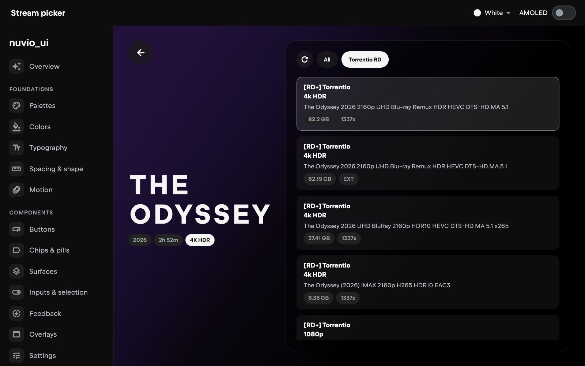
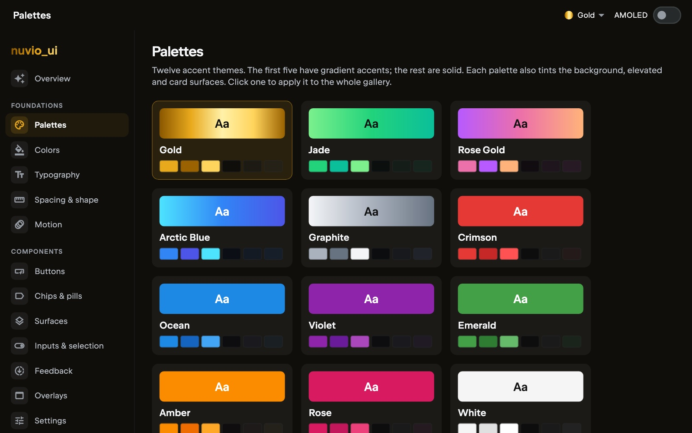
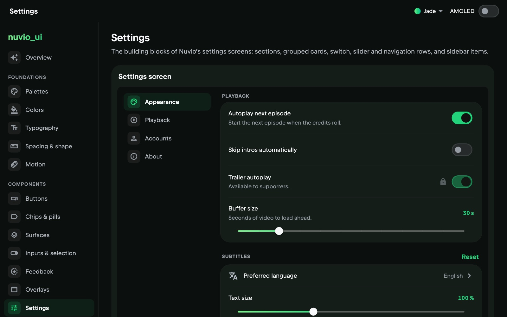
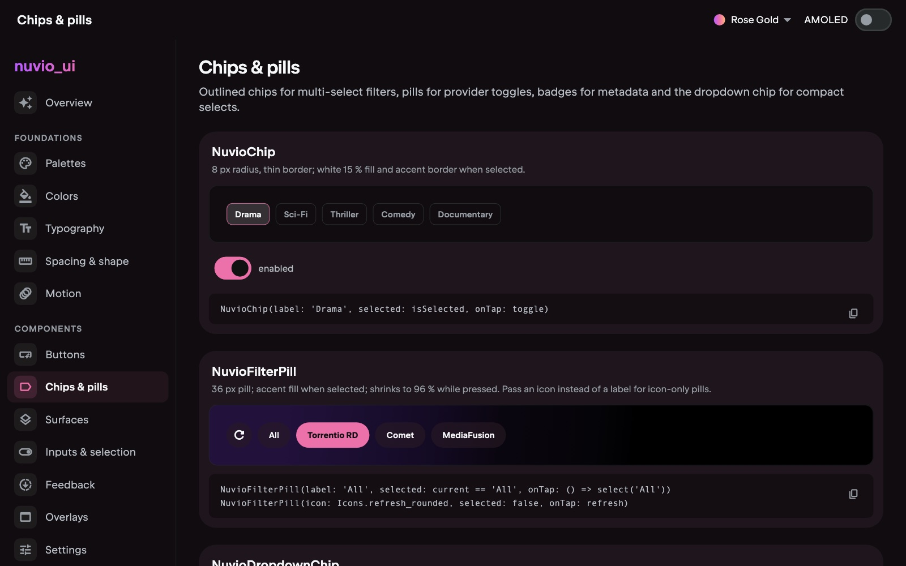
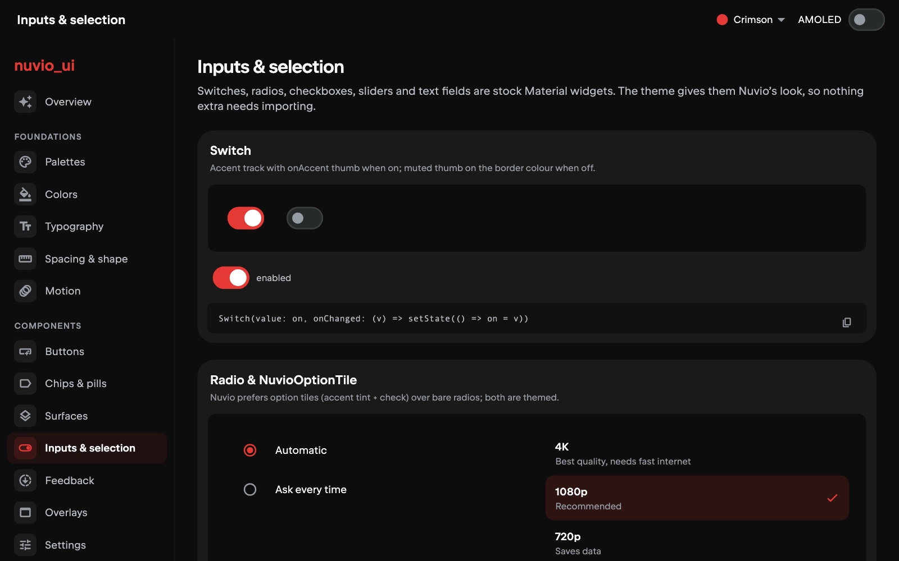
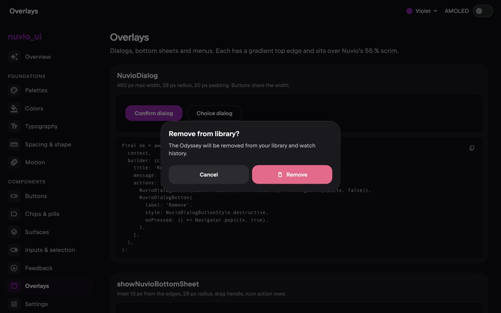
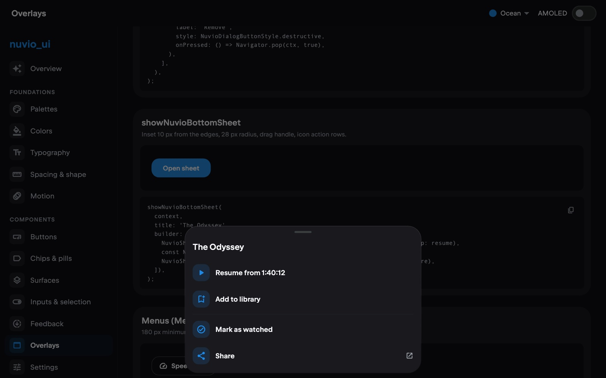
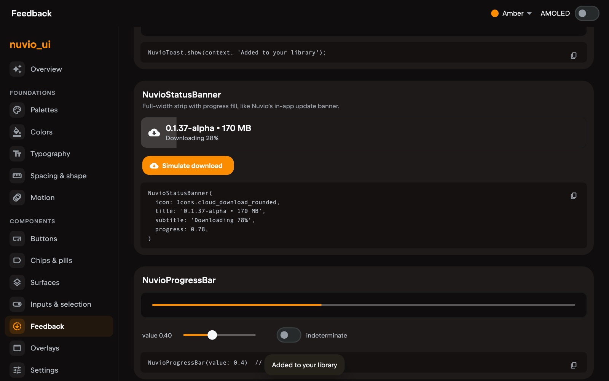
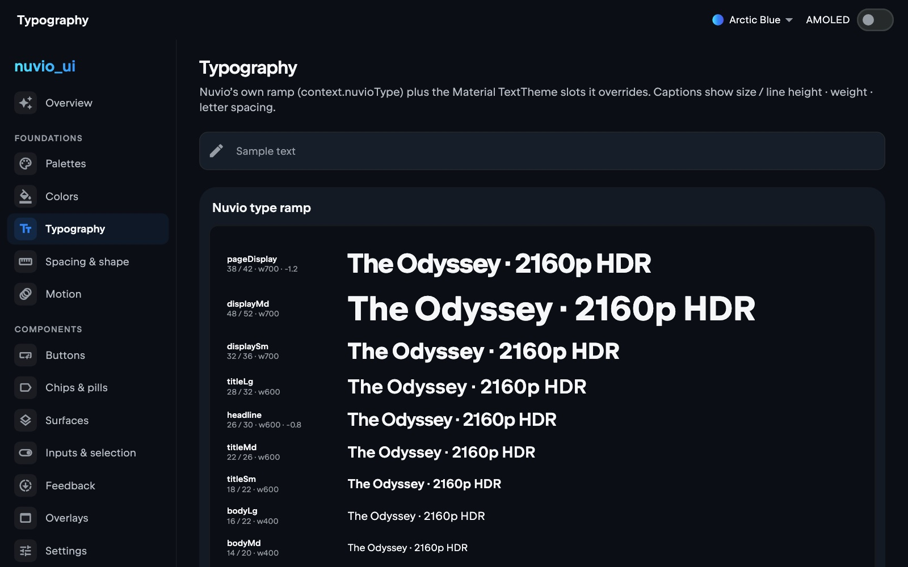

# nuvio_ui

A dark, cinematic Flutter design system modelled on the **Nuvio** desktop app.



It gives you a complete **dark-theme UI kit** for media, streaming and
entertainment apps:

- **Design tokens:** spacing, radius, elevation, motion, opacity, icon sizes and breakpoints.
- **12 accent colour palettes**, 5 of them with gradient accents.
- **A full Material 3 `ThemeData`**, so stock Flutter widgets match out of the box.
- **30+ ready-made widgets:** buttons, chips, pills, dialogs, bottom sheets, menus, toasts, settings rows, glass panels and more.

It has no third-party dependencies, works on every Flutter platform and needs
no state-management package. It works the same in plain, `flutter_hooks`,
Riverpod or Bloc apps.

> **Not affiliated with Nuvio.** This is an independent design system inspired
> by Nuvio's look. "Nuvio" is used only to describe that style.

## Contents

- [Screenshots](#screenshots)
- [Quick start](#quick-start)
- [Example](#example)
- [Using tokens](#using-tokens)
- [Palettes](#palettes)
- [Components](#components)
- [Themed Material widgets](#themed-material-widgets)
- [Fonts](#fonts)
- [Gallery app](#gallery-app)
- [FAQ](#faq)
- [Links](#links)

## Screenshots

| | |
|---|---|
|  |  |
| **Palettes:** 12 accent themes, 5 with gradients | **Settings:** sections, switch, slider and navigation rows |
|  |  |
| **Chips & pills:** chips, filter pills, dropdowns, badges | **Inputs:** themed switch, radio, checkbox, slider, text field |
|  |  |
| **Dialogs:** primary, secondary and destructive actions | **Bottom sheets:** inset sheet with icon action rows |
|  |  |
| **Feedback:** toast, status banner, progress, loading | **Typography:** the type ramp in JetBrains Sans |

All screenshots come from the [gallery app](#gallery-app) in `example/`.

## Quick start

```sh
flutter pub add nuvio_ui
```

```dart
import 'package:nuvio_ui/nuvio_ui.dart';

MaterialApp(
  theme: NuvioThemeData.build(
    NuvioPalette.arcticBlue, // any of NuvioPalette.all
    amoled: false,           // true = pure-black backgrounds for OLED
  ),
  home: const HomePage(),
);
```

That's all the setup. Every Material widget in your app now uses the Nuvio
look, and the `Nuvio*` widgets are ready to use.

## Using tokens

```dart
final c = context.nuvioColors; // semantic colour roles
final t = context.nuvioType;   // type ramp

Container(
  padding: const EdgeInsets.all(NuvioSpace.cardPadding),
  decoration: BoxDecoration(
    color: c.surfaceCard,
    borderRadius: NuvioRadius.all(NuvioRadius.card),
  ),
  child: Text('Continue watching', style: t.titleMd.copyWith(color: c.textPrimary)),
);
```

| Token set | Examples |
|---|---|
| `NuvioSpace` | `s4 … s96`, plus semantic `screenHorizontal 16`, `sectionGap 24`, `listGap 12`, `cardPadding 18`, `dialogPadding 20` |
| `NuvioRadius` | `xs 4 · sm 6 · md 8 · lg 12 · xl 16 · xxl 24 · full`, plus `card 24`, `dialog 28`, `button 16`, `poster 12` |
| `NuvioElevation` | `flat 0 · raised 2 · playerControls 4 · modal 8 · overlay 12` |
| `NuvioBorderWidth` | `hairline 0.5 · thin 1 · medium 2` |
| `NuvioIconSize` | `xs 12 · sm 16 · md 20 · lg 24 · xl 32 · xxl 40` |
| `NuvioMotion` | `fast 150ms · normal 220 · sheetEnter 300 · slow 400 · cinematic 700`; curves `standard`, `emphasized`, `decelerate`, `accelerate` |
| `NuvioOpacity` | `hover .08 · pressed .12 · selected .15 · disabled .38 · strong .75 …` |
| `NuvioBreakpoint` | `largePhone 420 · tablet 600 · largeTablet 840 · desktop 1024 · playerWide 1280` |
| `NuvioColors` (`context.nuvioColors`) | surfaces, text, accent and focus, borders, status, overlays, player, plus `accentGradient`, `surfaceEdge` and `overlayGradient` |
| `NuvioTypeScale` (`context.nuvioType`) | `labelXs 11 · labelSm 12 · bodySm 13 · bodyMd 14 · bodyLg 16 · titleSm 18 · titleMd 22 · titleLg 28 · displaySm 32 · displayMd 48`, plus `headline` and `pageDisplay` |

Some colours are the same in every palette:

- Text: primary `#F5F7F8`, secondary `#B8BEC5`, muted `#969CA3`
- Borders: `#252A2A` / `#3A4040`
- Status: success `#66BB6A`, warning `#FFC857`, danger `#E36A8A`, info `#42A5F5`

## Palettes

| Gradient accents | Solid accents |
|---|---|
| Gold, Jade, Rose Gold, Arctic Blue, Graphite | Crimson, Ocean, Violet, Emerald, Amber, Rose, White |

Each palette also tints the background, elevated and card surfaces.
`NuvioPalette.all` lists all 12, which is handy for a theme picker.
`palette.accentBrush` gives you the accent as a `LinearGradient`.

## Components

| Group | Widgets |
|---|---|
| Buttons | `NuvioPrimaryButton`, `NuvioCircleIconButton` (+ `.back`), `NuvioActionLabel`, `NuvioDialogButton` (primary / secondary / destructive) |
| Chips & badges | `NuvioChip`, `NuvioFilterPill`, `NuvioDropdownChip`, `NuvioInfoBadge`, `NuvioInlineMetadata` |
| Surfaces | `NuvioSurfaceCard`, `NuvioGlassPanel`, `NuvioListCard`, `NuvioEdgeOutlined`, `NuvioSectionLabel` |
| Overlays | `NuvioDialog` + `showNuvioDialog`, `showNuvioBottomSheet` + `NuvioSheetActionRow` / `NuvioSheetDivider`, `NuvioMenuItem` (for `MenuAnchor`), `NuvioToast.show` |
| Selection | `NuvioOptionTile` (radio-style row with check) |
| Settings | `NuvioSettingsSection`, `NuvioSettingsGroup`, `NuvioSwitchRow`, `NuvioSliderRow`, `NuvioNavigationRow`, `NuvioSidebarItem` |
| Feedback | `NuvioProgressBar`, `NuvioLoadingIndicator`, `NuvioSkeleton`, `NuvioStatusBanner`, `NuvioEmptyState`, `NuvioResumePrompt` |
| Utilities | `NuvioPressScale`, `NuvioGradientSliderTrack` |

```dart
// Confirm dialog
final ok = await showNuvioDialog<bool>(
  context,
  builder: (ctx) => NuvioDialog(
    title: 'Remove from library?',
    message: 'This also clears your watch history for the title.',
    actions: [
      NuvioDialogButton(label: 'Cancel', onPressed: () => Navigator.pop(ctx, false)),
      NuvioDialogButton(
        label: 'Remove',
        style: NuvioDialogButtonStyle.destructive,
        onPressed: () => Navigator.pop(ctx, true),
      ),
    ],
  ),
);

// Toast
NuvioToast.show(context, 'Added to your library');

// Settings
NuvioSettingsGroup(children: [
  NuvioSwitchRow(
    title: 'Autoplay next episode',
    value: autoplay,
    onChanged: (v) => setState(() => autoplay = v),
  ),
  NuvioNavigationRow(title: 'Language', value: 'English', onTap: openLanguages),
]);
```

## Themed Material widgets

The theme also styles stock widgets, so you can use them freely:

- `FilledButton`, `OutlinedButton`, `TextButton`
- `Switch`, `Radio`, `Checkbox`
- `Slider`, with the accent-gradient track
- `TextField`, `TabBar`, `MenuAnchor`, `PopupMenuButton`, `Tooltip`
- `ListTile`, `Card`, `AlertDialog`, bottom sheets, `SnackBar`
- progress indicators

## Fonts

**JetBrains Sans** (400 / 600 / 700) is bundled and used by default. To use
another font, pass its family name, or `null` for the platform font:

```dart
NuvioThemeData.build(palette, fontFamily: 'Inter');
NuvioThemeData.build(palette, fontFamily: null);
```

> ⚠️ **JetBrains Sans is not openly licensed.** Its metadata reads "All rights
> reserved", and JetBrains has not released it for redistribution. See
> [`assets/fonts/NOTICE.md`](assets/fonts/NOTICE.md). If you ship an app with
> nuvio_ui, consider passing your own `fontFamily`.

## Example

A complete, runnable app is in
[`example/lib/quick_start.dart`](example/lib/quick_start.dart) (also shown on
pub.dev's **Example** tab). Its key parts:

```dart
import 'package:flutter/material.dart';
import 'package:nuvio_ui/nuvio_ui.dart';

final palette = ValueNotifier(NuvioPalette.arcticBlue);

class QuickStartApp extends StatelessWidget {
  const QuickStartApp({super.key});

  @override
  Widget build(BuildContext context) => ValueListenableBuilder(
    valueListenable: palette,
    builder: (_, p, _) => MaterialApp(
      theme: NuvioThemeData.build(p), // 1. apply the theme
      home: const HomePage(),
    ),
  );
}

class HomePage extends StatelessWidget {
  const HomePage({super.key});

  @override
  Widget build(BuildContext context) {
    final c = context.nuvioColors; // 2. read tokens from context
    final t = context.nuvioType;

    return Scaffold(
      body: ListView(
        padding: const EdgeInsets.all(NuvioSpace.s24),
        children: [
          Text('The Odyssey', style: t.pageDisplay.copyWith(color: c.textPrimary)),
          NuvioPrimaryButton(
            label: 'Play',
            icon: Icons.play_arrow_rounded,
            onPressed: () => NuvioToast.show(context, 'Starting playback…'),
          ),
          // 3. Switch palettes at runtime.
          Wrap(spacing: NuvioSpace.s8, children: [
            for (final option in NuvioPalette.all.take(5))
              NuvioFilterPill(
                label: option.name,
                selected: option == palette.value,
                onTap: () => palette.value = option,
              ),
          ]),
          // 4. Components: a list card that opens a dialog.
          NuvioListCard(
            onTap: () => showNuvioDialog<void>(
              context,
              builder: (ctx) => NuvioDialog(
                title: 'Play in 1080p?',
                actions: [
                  NuvioDialogButton(label: 'Cancel', onPressed: () => Navigator.pop(ctx)),
                  NuvioDialogButton(
                    label: 'Play',
                    style: NuvioDialogButtonStyle.primary,
                    onPressed: () => Navigator.pop(ctx),
                  ),
                ],
              ),
            ),
            child: Text('1080p', style: t.bodyMd.copyWith(color: c.textPrimary)),
          ),
        ],
      ),
    );
  }
}
```

## Gallery app

`example/` is a widget-book-style gallery. It has a page for every token and
component, live controls, copyable code snippets, and a palette and AMOLED
switcher.

```sh
cd example
flutter run -d macos             # or an iPad/iPhone simulator, Android, Chrome…
```

Run with `--dart-define=GALLERY_TOUR=true` to step through the key pages
automatically. `tool/update_screenshots.sh` regenerates the screenshots above
from the gallery (macOS; use `FLUTTER="fvm flutter"` with FVM).

## FAQ

**Do I need `flutter_hooks`?** No. The package is design tokens plus widgets
that need no state management. The only internal state is a press animation
and the skeleton shimmer. The gallery uses hooks, but your app doesn't have
to.

**Light mode?** The style is dark only, by design. `amoled: true` gives pure
black backgrounds.

**Desktop scaling?** `NuvioThemeData.desktopUiScale(windowSize)` returns
`clamp(min(w/1280, h/820), 1.0, 1.18)`. Combine it with
`NuvioThemeData.desktopFontScale` (1.08) to scale the UI with large windows.

## Links

- **Repository:** https://github.com/alvynfash/nuvio-ui
- **Issues:** https://github.com/alvynfash/nuvio-ui/issues
- **API reference:** https://pub.dev/documentation/nuvio_ui/latest/
- **Changelog:** [CHANGELOG.md](CHANGELOG.md)

## License

The code is under the [MIT License](LICENSE). The bundled font files in
`assets/fonts/` are **not** covered by it; see their
[NOTICE](assets/fonts/NOTICE.md).
