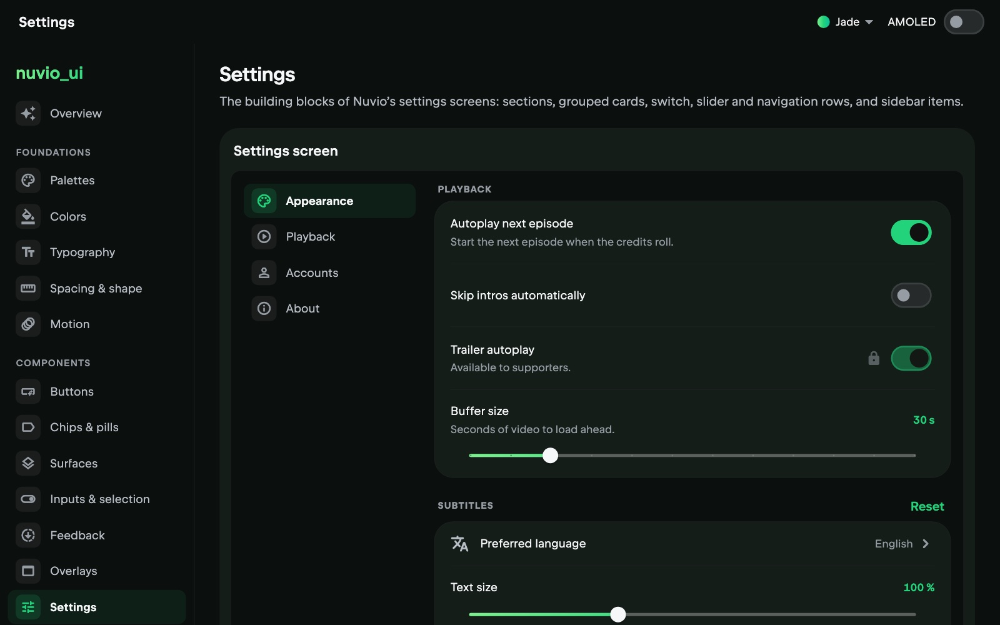

# nuvio_ui examples

## Quick start

A complete app showing the theme, runtime palette switching, list cards, a
dialog, a toast and a settings group. The source is
[`lib/quick_start.dart`](lib/quick_start.dart):

```sh
flutter run -t lib/quick_start.dart
```

```dart
// A minimal nuvio_ui app: theme, palette switching, cards, a dialog, a toast
// and a settings group. Run: flutter run -t lib/quick_start.dart

import 'package:flutter/material.dart';
import 'package:nuvio_ui/nuvio_ui.dart';

void main() => runApp(const QuickStartApp());

final palette = ValueNotifier(NuvioPalette.arcticBlue);
final autoplay = ValueNotifier(true);

class QuickStartApp extends StatelessWidget {
  const QuickStartApp({super.key});

  @override
  Widget build(BuildContext context) => ValueListenableBuilder(
    valueListenable: palette,
    builder:
        (_, p, _) => MaterialApp(
          theme: NuvioThemeData.build(p), // 1. apply the theme
          home: const HomePage(),
        ),
  );
}

class HomePage extends StatelessWidget {
  const HomePage({super.key});

  @override
  Widget build(BuildContext context) {
    final c = context.nuvioColors; // 2. read tokens from context
    final t = context.nuvioType;

    return Scaffold(
      body: ListView(
        padding: const EdgeInsets.all(NuvioSpace.s24),
        children: [
          Text(
            'The Odyssey',
            style: t.pageDisplay.copyWith(color: c.textPrimary),
          ),
          const SizedBox(height: NuvioSpace.s8),
          const Wrap(
            spacing: NuvioSpace.s6,
            children: [
              NuvioInfoBadge('2026'),
              NuvioInfoBadge('2h 52m'),
              NuvioInfoBadge('4K HDR', accent: true),
            ],
          ),
          const SizedBox(height: NuvioSpace.s16),
          NuvioPrimaryButton(
            label: 'Play',
            icon: Icons.play_arrow_rounded,
            onPressed: () => NuvioToast.show(context, 'Starting playback…'),
          ),
          const SizedBox(height: NuvioSpace.sectionGap),

          // 3. Switch palettes at runtime.
          Wrap(
            spacing: NuvioSpace.s8,
            children: [
              for (final option in NuvioPalette.all.take(5))
                NuvioFilterPill(
                  label: option.name,
                  selected: option == palette.value,
                  onTap: () => palette.value = option,
                ),
            ],
          ),
          const SizedBox(height: NuvioSpace.sectionGap),

          // 4. Components: list cards that open a dialog.
          for (final quality in const ['2160p HDR', '1080p', '720p']) ...[
            NuvioListCard(
              onTap:
                  () => showNuvioDialog<void>(
                    context,
                    builder:
                        (ctx) => NuvioDialog(
                          title: 'Play in $quality?',
                          message: 'Streams start in a few seconds.',
                          actions: [
                            NuvioDialogButton(
                              label: 'Cancel',
                              onPressed: () => Navigator.pop(ctx),
                            ),
                            NuvioDialogButton(
                              label: 'Play',
                              style: NuvioDialogButtonStyle.primary,
                              onPressed: () => Navigator.pop(ctx),
                            ),
                          ],
                        ),
                  ),
              child: Text(
                quality,
                style: t.bodyMd.copyWith(color: c.textPrimary),
              ),
            ),
            const SizedBox(height: NuvioSpace.listGap),
          ],
          const SizedBox(height: NuvioSpace.sectionGap),

          // 5. Settings rows.
          NuvioSettingsSection(
            title: 'Playback',
            child: NuvioSettingsGroup(
              children: [
                ValueListenableBuilder(
                  valueListenable: autoplay,
                  builder:
                      (_, on, _) => NuvioSwitchRow(
                        title: 'Autoplay next episode',
                        value: on,
                        onChanged: (v) => autoplay.value = v,
                      ),
                ),
                NuvioNavigationRow(
                  title: 'Language',
                  value: 'English',
                  onTap: () {},
                ),
              ],
            ),
          ),
        ],
      ),
    );
  }
}
```

## Gallery

`lib/main.dart` is a widget-book-style gallery with a page for every token and
component, live controls, copyable code snippets, and a palette and AMOLED
switcher:

```sh
flutter run            # any device: macOS, iOS/Android simulator, Chrome…
```

- `--dart-define=GALLERY_TOUR=true` steps through the key pages automatically.
- `../tool/update_screenshots.sh` regenerates the README and pub.dev
  screenshots (macOS).


